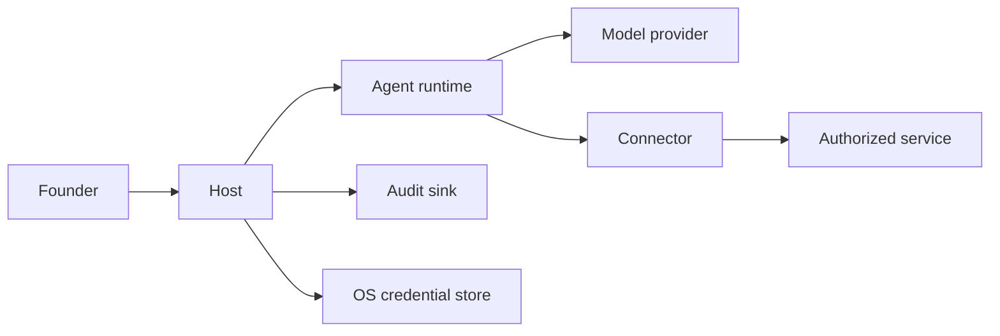

# Damdle Agents

**Portable, permissioned agents for the Damdle ecosystem and the tools founders already use.**

[](https://github.com/Damdle/damdle-agents/actions/workflows/ci.yml)
[](LICENSE)
[](https://nodejs.org/)

Damdle Agents is the open-source actor layer for Damdle: a small runtime,
clear connector contracts, explicit permissions, and reviewable actions. Run an
agent locally, connect it to a user-authorized service, and keep the authority
to approve consequential actions with the founder.

> **Status: experimental.** The local host and connectors are for development
> and evaluation. They are not a production deployment recipe.

## Why this project exists

Agents become useful when they can work across the places where people already
work. They also need a clear boundary around what they can see and do.
Damdle Agents makes that boundary explicit:

- **Portable:** provider-neutral contracts and a small runtime.
- **Permissioned:** named scopes are granted by the host and checked again by
  the connected service.
- **Reviewable:** draft and write-capable tools produce inspectable proposals.
- **Connected:** connectors adapt services without copying their databases or
  application runtimes.
- **Auditable:** hosts record enough event metadata to explain an agent turn
  without writing prompts, tool results, or credentials to the audit log.

## Included in this repository

- A bounded agent runtime and JSON Schema tool dispatcher.
- Portable contracts for agents, tools, scopes, connectors, proposals, and
  audit events.
- A local Node.js host with OAuth, local scope consent, encrypted chat history,
  and OS credential-store integration.
- A first-party Damdle MCP connector.
- A manifest-driven generic MCP connector for explicit read and draft tools.
- An OpenAI Responses API adapter with `store: false` requests.
- Credential-free demos and JSON agent manifests.

The public architecture boundary explains what is included and what is kept in
the Damdle service: [architecture boundary](docs/architecture-boundary.md).

## Try the demos

Requirements: Node.js 22.6 or newer.

```bash
npm ci
npm run demo
npm run demo:mcp
```

The demos use in-memory sample data and do not require credentials. To compile
the workspace and run the local CLI help:

```bash
npm run build
npm run agent -- --help
```

## Connect a local agent

The local host connects to a Damdle MCP endpoint through a founder-authorized
OAuth flow. It keeps OAuth material in the operating-system credential store,
encrypts resumable conversations with AES-256-GCM, and asks for requested
connector scopes explicitly.

Read the [local host guide](packages/hosts/node-local/README.md) before using
an account. You will need a Damdle MCP URL, a tool-capable model endpoint, and
an API key. Do not connect production accounts until the security review and a
supported self-hosting recipe are published.

## Build a custom agent

Agent definitions are JSON data. Start with the example in
[`agents/founder-guide.json`](agents/founder-guide.json), request the narrowest
scopes needed, and run it with:

```bash
npm run agent -- --agent ./agents/my-agent.json "Help me with this task"
```

The host does not execute code from an agent manifest. A manifest does not
sandbox connectors; installed connector code is trusted code in this release.

## Architecture



The host resolves connections and grants from trusted local state. Models and
tool results are treated as untrusted input. Connectors validate their inputs
and the connected service remains responsible for authentication and
authorization.

## Documentation

| Guide | Purpose |
| --- | --- |
| [Architecture](docs/architecture.md) | Runtime layers and trust boundaries |
| [Architecture boundary](docs/architecture-boundary.md) | Public project scope and exclusions |
| [Integration strategy](docs/integration-strategy.md) | How to design and review connectors |
| [Self-hosting](docs/self-hosting.md) | Current local deployment boundary and data storage |
| [Versioning](docs/versioning.md) | Experimental interfaces and compatibility policy |
| [Agent definitions](agents/README.md) | Create and run JSON manifests |
| [Security](SECURITY.md) | Vulnerability reporting and security boundaries |
| [Contributing](CONTRIBUTING.md) | Contribution and DCO requirements |
| [Trademark policy](TRADEMARK.md) | Use of the Damdle name and marks |

## Project status

This is an early, experimental release line. The core contracts, dispatcher,
local demos, MCP adapters, OAuth host, encrypted local history, and model
adapter are implemented. Live Damdle account compatibility, cross-platform
credential lifecycle validation, connector sandboxing, and a production
self-hosting recipe remain future work.

Follow the [roadmap](docs/roadmap.md) for the current direction. Interfaces,
manifest formats, scopes, and persistence formats may change before the first
stable release.

## Security and privacy

Read [SECURITY.md](SECURITY.md) before connecting an account. Never commit
credentials, private user data, production audit logs, or service secrets. The
project does not sandbox connector code, so only install connectors you trust.

To report a vulnerability, email **security@damdle.com**. Do not include
vulnerability details in a public issue.

## License

The software is licensed under the [Apache License 2.0](LICENSE), Copyright
2026 Damdle. Damdle names, logos, and mascot artwork are trademarks and are
covered separately by the [Damdle Trademark Policy](TRADEMARK.md).

Contributions use the [Developer Certificate of Origin](https://developercertificate.org/).
Every commit must include a DCO sign-off; see [CONTRIBUTING.md](CONTRIBUTING.md).
